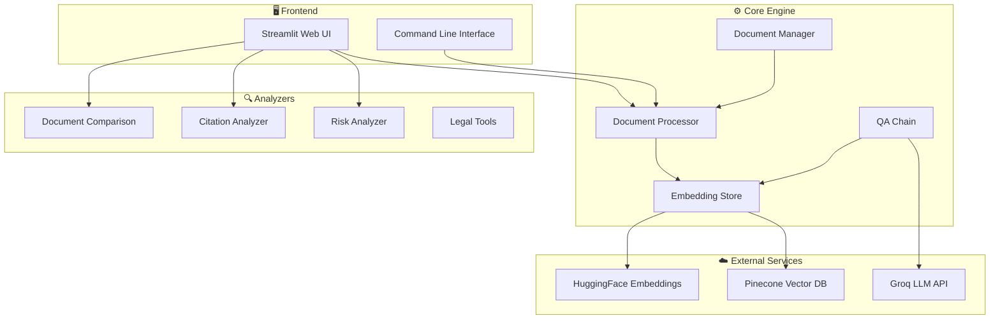
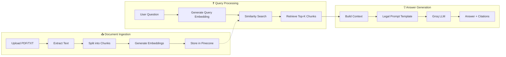
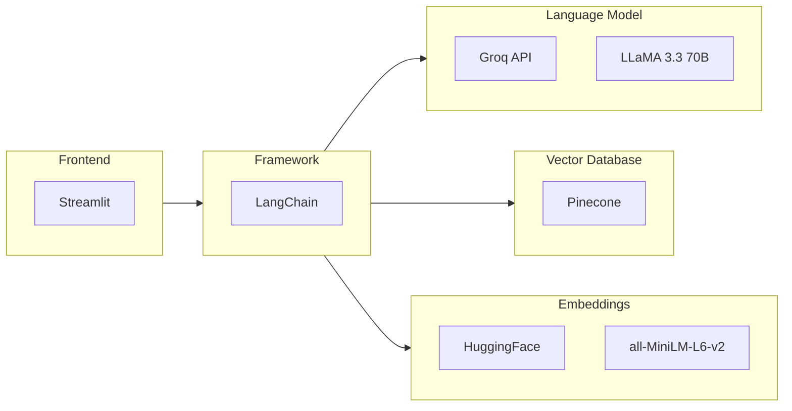

# 🏛️ Indian Legal Document Analyzer

[](https://python.org)
[](https://streamlit.io)
[](https://langchain.com)
[](LICENSE)

A **RAG (Retrieval-Augmented Generation)** based legal document analysis system designed specifically for **Indian legal documents**. Upload Acts, Judgments, or Contracts and ask questions using natural language.

---

## 🎯 Features

| Feature | Description |
|---------|-------------|
| 📄 **Document Processing** | Upload PDF/TXT legal documents |
| ❓ **Q&A System** | Ask questions using natural language |
| ⚖️ **Risk Analysis** | Identify risky clauses in contracts |
| 📊 **Citation Analysis** | Extract SCC, AIR, Constitution citations |
| 🔍 **Document Comparison** | Compare two legal documents side-by-side |
| 🏷️ **Entity Extraction** | Identify parties, dates, monetary values |

---

## 🏗️ System Architecture



---

## 🔄 RAG Pipeline Flow



---

## 📁 Project Structure

```
Indian-Legal-Document-Analyzer/
├── app/                        # 🖥️ Application Interfaces
│   ├── __init__.py
│   ├── web_interface.py        # Streamlit web UI
│   └── cli.py                  # Command-line interface
│
├── core/                       # ⚙️ Core Components
│   ├── __init__.py
│   ├── document_processor.py   # PDF/TXT loading & chunking
│   ├── embedding_store.py      # Pinecone vector operations
│   ├── qa_chain.py             # LangChain QA with Groq
│   └── document_manager.py     # Multi-document management
│
├── analyzers/                  # 🔍 Analysis Modules
│   ├── __init__.py
│   ├── risk_analyzer.py        # Contract risk detection
│   ├── citation_analyzer.py    # Legal citation extraction
│   ├── comparison.py           # Document comparison
│   └── legal_tools.py          # Utility functions
│
├── config/                     # ⚙️ Configuration
│   ├── __init__.py
│   └── settings.py             # Centralized settings
│
├── data/samples/               # 📂 Sample Documents
├── tests/                      # 🧪 Test Files
│
├── .env.example                # Environment template
├── requirements.txt            # Dependencies
├── run.py                      # Entry point
└── README.md                   # This file
```

---

## 🚀 Quick Start

### 1. Clone & Install

```bash
git clone https://github.com/Shubham00-3/Indian-Legal-Document-Analyzer.git
cd Indian-Legal-Document-Analyzer
pip install -r requirements.txt
```

### 2. Configure Environment

```bash
cp .env.example .env
```

Edit `.env` with your API keys:

```env
# Groq API (https://console.groq.com/)
GROQ_API_KEY=your_groq_api_key
GROQ_MODEL_NAME=llama-3.3-70b-versatile

# Pinecone (https://www.pinecone.io/)
PINECONE_API_KEY=your_pinecone_api_key
PINECONE_ENVIRONMENT=us-east-1
PINECONE_INDEX_NAME=legal-docs
```

### 3. Create Pinecone Index

1. Go to [Pinecone Console](https://app.pinecone.io/)
2. Create new index with:
   - **Dimensions**: `384`
   - **Metric**: `cosine`

### 4. Run the Application

```bash
# Web Interface
streamlit run app/web_interface.py

# Or use the entry point
python run.py
```

---

## 🔧 Technology Stack



| Component | Technology | Purpose |
|-----------|------------|---------|
| **Frontend** | Streamlit | Interactive web UI |
| **LLM** | Groq (LLaMA 3.3 70B) | Fast inference |
| **Vector DB** | Pinecone | Semantic search |
| **Embeddings** | HuggingFace (MiniLM) | Text vectorization |
| **Framework** | LangChain | LLM orchestration |

---

## 📖 Usage Guide

### Upload & Process Documents

1. Navigate to **Upload Document**
2. Select a PDF or TXT file
3. Choose document type (Act, Contract, Judgment, etc.)
4. Click **Process Document**

### Ask Questions

Navigate to **Ask Questions** and try:

- *"What are the key provisions of this document?"*
- *"What penalties are mentioned?"*
- *"Who are the parties involved?"*
- *"What is the jurisdiction?"*

### Analyze Risks

For contracts, use **Document Analysis** to:
- Identify ambiguous terms
- Find one-sided clauses
- Detect missing provisions
- Get improvement suggestions

### Extract Citations

Use **Citation Analysis** to extract:
- Case citations (SCC, AIR)
- Statute references
- Constitutional provisions
- Section references

---

## 🔍 How It Works

### Document Processing Pipeline

1. **Load**: Extract text from PDF/TXT
2. **Chunk**: Split into 1000-char segments with 200-char overlap
3. **Embed**: Generate 384-dim vectors using MiniLM
4. **Store**: Index in Pinecone with metadata

### Query Pipeline

1. **Embed Query**: Convert question to vector
2. **Search**: Find top-5 similar chunks
3. **Build Context**: Combine relevant chunks
4. **Generate**: Use legal-specific prompt with Groq
5. **Return**: Answer with citations

---

## 📊 Indian Legal Citation Patterns

The system recognizes:

| Type | Pattern | Example |
|------|---------|---------|
| SCC | `(YYYY) N SCC N` | (2023) 5 SCC 123 |
| AIR | `AIR YYYY SC N` | AIR 2023 SC 456 |
| Constitution | `Article N` | Article 21 |
| Section | `Section N` | Section 302 IPC |

---

## 🛠️ Development

### Run Tests

```bash
python -m pytest tests/
```

### Code Structure

- **core/**: Independent of UI, can be used as library
- **analyzers/**: Pluggable analysis modules
- **app/**: UI implementations (web, CLI)

---

## 📄 License

MIT License - feel free to use for personal and commercial projects.

---

## 🤝 Contributing

Contributions welcome! Please:
1. Fork the repository
2. Create a feature branch
3. Submit a pull request

---

## 📧 Contact

**Shubham** - [GitHub](https://github.com/Shubham00-3)

---

<p align="center">
  Made with ❤️ for the Indian Legal Tech Community
</p>
